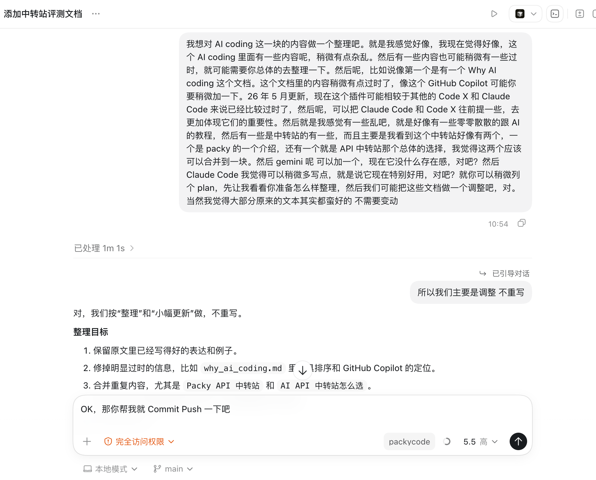

# AI 使用实践：Agent 能做什么

现在再纠结“AI 到底好不好用”，意义已经不大了。学习、写作、编程、整理资料这些事，AI 都已经足够好用。真正拉开差距的，不是谁记得更多模型名字，而是谁更会把 AI 用进自己的日常流程里。

先随便列几个方向，看看 Agent 能做什么：

- 读一整个代码仓库，解释你看不懂的调用链；
- 把口述的一堆想法整理成 PRD 或计划；
- 写个小脚本，自动整理电脑里的文件；
- 接上浏览器，帮你搜集和整理资料；
- 定时提醒、主动推送你该做的事；
- 把一次性的任务流程，固化成下次能直接复用的 skill。

这篇文档主要记录我自己的实践，素材来自我的几篇博客。它不是标准答案，更像一些真实的尝试——有的顺利，有的粗糙，有的只是阶段性的想法。

## 核心观点

用 AI 的能力，大致可以拆成四件事：

1. **把话说清楚**：把脑子里的想法快速、完整地讲出来。
2. **把任务拆细**：把一句模糊的需求，拆成 AI 能做、你能验证的小步骤。
3. **会用工具**：让 AI 不只聊天，还能读文件、查网页、调脚本、记事情。
4. **知道分寸**：什么时候让它放手做，什么时候必须自己看一眼。

很多人觉得 AI 不好用，往往不是模型不行，而是输入太慢、需求太糊、任务太大、没法验证。你越能把问题讲清楚、把步骤拆细、把检查点想好，它就越像个靠谱的搭档。

## 实践索引

| 时间 | 博客 | 做了什么 |
|---|---|---|
| 2026-04-05 | [语音输入：typeless vs 豆包输入法](https://baokker-blog.top/2026/04/05/%E8%AF%AD%E9%9F%B3%E8%BE%93%E5%85%A5%EF%BC%9Atypeless-vs-%E8%B1%86%E5%8C%85%E8%BE%93%E5%85%A5%E6%B3%95/) | 对比两款语音输入工具，解决“想法变成文字”的速度问题 |
| 2026-04-06 | [用 Claude Code 搓了一个 MacOS 语音输入 tool](https://baokker-blog.top/2026/04/06/%E7%94%A8Claude-Code%E6%90%93%E4%BA%86%E4%B8%80%E4%B8%AAMacOS%E8%AF%AD%E9%9F%B3%E8%BE%93%E5%85%A5tool/) | 让 Claude Code 从需求一路做到打包，做出一个 macOS 语音输入小工具 |
| 2026-04-26 | [我放心地打开了 Claude Code 的 skip dangerous permission](https://baokker-blog.top/2026/04/26/%E6%88%91%E6%94%BE%E5%BF%83%E5%9C%B0%E6%89%93%E5%BC%80%E4%BA%86-Claude-code-%E7%9A%84skip-dangerous-permission/) | 记录深度使用后对权限放开的权衡 |
| 2026-05-02 | [我的 Hermes 养记](https://baokker-blog.top/2026/05/02/%E6%88%91%E7%9A%84Hermes%E5%85%BB%F0%9F%90%8E%E8%AE%B0/) | 把 AI 接进消息平台、提醒和记忆，做成长期在线的入口 |
| 2026-05-05 | [用 Hermes Agent 写了一个小红书博主分析 skill](https://baokker-blog.top/2026/05/05/%E7%94%A8-Hermes-Agent-%E5%86%99%E4%BA%86%E4%B8%80%E4%B8%AA%E5%B0%8F%E7%BA%A2%E4%B9%A6%E5%8D%9A%E4%B8%BB%E5%88%86%E6%9E%90-skill/) | 用 Agent 抓取整理内容，并沉淀成可复用的 skill |
| 2026-09-18 | [实习 4 个月，我对 AI 的新感受](https://baokker-blog.top/2026/09/18/%E5%AE%9E%E4%B9%A0-4-%E4%B8%AA%E6%9C%88%EF%BC%8C%E6%88%91%E5%AF%B9-AI-%E7%9A%84%E6%96%B0%E6%84%9F%E5%8F%97/) | 实习中大量用 AI 后的体会，包括 AI 的局限、按任务选模型、让 Harness 与模型匹配 |
| 2026-10-19 | [我推荐安装的 MacOS 软件（2026 年版）](https://baokker-blog.top/2026/10/19/%E6%88%91%E6%8E%A8%E8%8D%90%E5%AE%89%E8%A3%85%E7%9A%84MacOS%E8%BD%AF%E4%BB%B6%EF%BC%882026%E5%B9%B4%E7%89%88%EF%BC%89/) | 日常提效的 macOS 软件清单，含终端、输入法、Agent 等 |
| 2026-11-01 | [年少不能遇见太惊艳的 AI](https://baokker-blog.top/2026/11/01/%E5%B9%B4%E5%B0%91%E4%B8%8D%E8%83%BD%E9%81%87%E8%A7%81%E5%A4%AA%E6%83%8A%E8%89%B3%E7%9A%84AI/) | 对比不同模型的协作体验，讨论模型能力如何改变工作方式 |

下面挑几篇展开讲讲。

## 语音输入

AI 对话质量很大程度上取决于输入质量。如果每次只能慢慢打字，很多想法还没说清楚就已经散掉了。语音输入的价值，就是把“脑子里的连续想法”快速转成文字。

在 [语音输入：typeless vs 豆包输入法](https://baokker-blog.top/2026/04/05/%E8%AF%AD%E9%9F%B3%E8%BE%93%E5%85%A5%EF%BC%9Atypeless-vs-%E8%B1%86%E5%8C%85%E8%BE%93%E5%85%A5%E6%B3%95/) 里，核心对比不是哪个工具绝对更强，而是两类输入风格：

- 豆包输入法更适合日常表达，保留人的语气和原始表达。
- Typeless 更适合给 AI 下任务，会自动整理成更有结构的文本。

用 AI 不只是选模型，也要给自己搭一个顺手的输入通道。输入效率提升几倍，往往比换个模型更立竿见影。

## 用 Agent 做完整小工具

[用 Claude Code 搓了一个 MacOS 语音输入 tool](https://baokker-blog.top/2026/04/06/%E7%94%A8Claude-Code%E6%90%93%E4%BA%86%E4%B8%80%E4%B8%AAMacOS%E8%AF%AD%E9%9F%B3%E8%BE%93%E5%85%A5tool/) 是一个很典型的 vibe coding 案例。

这件事里，AI 做的不只是写几段代码，而是参与了完整流程：

1. 先把需求整理成 PRD。
2. 调研语音输入 API、技术栈和实现方案。
3. 做出 Python 原型。
4. 根据体验问题调整快捷键和菜单栏反馈。
5. 遇到打包和权限问题后，改成 Swift / Xcode 方案。
6. 最后帮助完成构建、排错和 git 提交。

这里的角色变化是：人从“逐行写代码的人”，变成了“定义目标、判断体验、调整方向、验收结果的人”。代码能力仍然重要，只是在 AI coding 里，需求捕捉、产品判断和验证意识的分量更重了。

这类黑盒开发适合个人工具、低风险原型、能手动验证的小项目；如果是生产系统、涉及数据安全或多人协作，还是得自己盯着代码。

## 权限放开

[我放心地打开了 Claude Code 的 skip dangerous permission](https://baokker-blog.top/2026/04/26/%E6%88%91%E6%94%BE%E5%BF%83%E5%9C%B0%E6%89%93%E5%BC%80%E4%BA%86-Claude-code-%E7%9A%84skip-dangerous-permission/) 这篇很短，但它触到了 Agent 使用里一个很真实的问题：每次都点批准，会打断自动化；完全放权，又会让人担心风险。

实际操作里，更合理的方式是分场景：

| 场景 | 建议 |
|---|---|
| 玩具项目、个人脚本、干净仓库 | 可以更大胆地放权，让 Agent 连续执行 |
| 有 git 管理、改动范围清楚的项目 | 可以放开读文件、跑测试、常规命令，但保留对删除、部署、密钥相关操作的审查 |
| 生产环境、敏感数据、公司仓库 | 不建议盲目跳过权限，至少要限制目录、命令和网络行为 |
| 不确定 Agent 会做什么 | 先让它输出计划，再授权执行 |

权限说到底是成本权衡：频繁批准浪费时间，错误操作又可能带来损失。放不放权，看你在什么环境里。

## Hermes 实践

[我的 Hermes 养记](https://baokker-blog.top/2026/05/02/%E6%88%91%E7%9A%84Hermes%E5%85%BB%F0%9F%90%8E%E8%AE%B0/) 展示的是另一种方向：AI 不只是你临时打开的网页聊天框，而是可以接进消息平台、提醒事项、个人资料和记忆系统的长期入口。

这篇文章里做了几件事：

- 用 DeepSeek API 控制成本。
- 配置 Hermes Agent 和模型。
- 接入 Telegram、微信或 QQ 等消息平台。
- 让 Agent 读取 Notion、Apple Notes、提醒事项等资料。
- 用 Reminders 和 Cron 做一次性提醒和主动 push。
- 让 Agent 逐渐理解个人偏好，并沉淀 memory 和 skill。

这个方向的重点，是让它更懂你真实的上下文——你的资料、习惯、待办和表达偏好。这比一个空白聊天窗口有用得多。

不过个人资料、备忘录、提醒事项都比较敏感。总结、提醒、生成内容可以放心交给它；删除、批量修改、外发、授权登录态这些操作，最好自己再确认一下。

## 沉淀成 skill

[用 Hermes Agent 写了一个小红书博主分析 skill](https://baokker-blog.top/2026/05/05/%E7%94%A8-Hermes-Agent-%E5%86%99%E4%BA%86%E4%B8%80%E4%B8%AA%E5%B0%8F%E7%BA%A2%E4%B9%A6%E5%8D%9A%E4%B8%BB%E5%88%86%E6%9E%90-skill/) 展示的是更高级的一步：把做完一次就丢的流程固化成 skill。

这篇文章里的任务是研究一个小红书博主。大致流程是：

1. 用 OpenCLI 复用浏览器登录态，抓取博主帖子列表。
2. 提取正文、标题、标签等结构化信息。
3. 下载图片和视频素材到本地。
4. 整理成一个 study 文件夹。
5. 输出 Markdown 学习文档，提炼博主的方法论。
6. 再生成一个后续 prompt，交给更强的视觉模型继续分析图片和视频。
7. 确认流程可行后，把它沉淀为 skill，下次直接复用。

这体现了两个很关键的 practice。

第一是**流程复用**：一次复杂任务，如果未来可能重复，就值得沉淀成 skill、脚本或模板。

第二是**模型分层**：爬取、下载、粗整理这类体力活可以交给便宜模型；图片理解、视频分析、方法论提炼这类高价值环节再交给 Claude 或 GPT。不是所有步骤都需要最贵模型。

另外，平台内容抓取会涉及登录态、版权、隐私和平台规则。自己学习和研究没问题，未经许可的大规模搬运、公开再分发或商业化使用就不合适了。

## 重复的事，都可以尝试交给 AI

如果只记一条建议，就是这一条：**所有你觉得重复、想提效的工作，都可以先试着让 AI 去做**。不用先判断它能不能做好，试一次就知道。

我自己用得比较多的场景有这些：

| 场景 | AI 可以帮什么 | 相关文档 |
|---|---|---|
| 整理文档 | 把口述、碎片笔记、聊天记录整理成结构清楚的 Markdown，并归档到合适位置 | [如何编辑本文档](/random_notes/how_to_write_this_doc.md) |
| 读文献 | 翻译、按固定问题讲解论文、做文献综述的初稿 | [用 AI 读论文](/random_notes/reading_papers_with_ai.md)、[如何进行文献综述](/random_notes/how_to_write_a_literature_review.md) |
| 写论文 | 润色、查逻辑、去掉 AI 腔，按自己的标准做一轮自查 | [用 AI 写论文](/ai_coding/ai_paper_writing_tutorial.md) |
| 做 PPT | 从大纲生成页面结构，再由人调整版式和内容 | |
| 画流程图 | 让 AI 生成 drawio、Mermaid 等源文件，再微调 | |
| 写代码 | 读仓库、写功能、排错、补测试 | [如何用 AI 高效编程](/ai_coding/pair_programming_with_ai.md) |
| 梳理思路 | 把一团乱麻的想法讲给 AI，让它追问、归纳、列出待决策的点 | |
| 安排个人事项 | 待办拆解、提醒、日程安排、周报 | 见上文 Hermes 实践 |

这张表不是穷举。判断标准很简单，只要一件事你已经做过第二遍，就该想一想能不能交给 AI。

### 用合适的 Harness、Agent 和模型做合适的任务

AI 用得好不好，除了会不会说清需求，还取决于三件事有没有选对。

- **Harness**，即模型外面的那层运行环境，比如 Claude Code、Codex、Cursor。它决定了模型能读什么文件、能跑什么命令、怎么管理上下文。同一个模型放进不同的 Harness，表现可能差很多。
- **Agent**，即具体承担任务的角色和流程。一次性问答用对话就够了，需要连续读文件、改文件、跑测试的任务才需要 Agent。
- **模型**，决定了理解力、表达和成本。简单任务（格式整理、翻译、批量改写）用便宜模型就够，复杂的设计、调试和长文写作再用强模型。

选配的大致思路如下，具体用哪个产品会随时间变化，以[AI 中转站怎么选](/ai_coding/api_relay_station_selection.md)里的最新推荐为准。

| 任务类型 | 倾向的选择 |
|---|---|
| 查一个概念、问一个小问题 | 带联网的对话产品，不需要 Agent |
| 批量、重复、容易验证的活 | 便宜的模型加简单的 Harness |
| 读大型代码库、跨文件改动 | 强模型加 Coding Agent |
| 写作和润色 | 表达自然的模型，再配合去 AI 腔的 skill |
| 长时间无人值守的任务 | 先限定权限和目录，再放手 |

这个能力没法靠看文档学会，只能靠练。建议的练法是，每次遇到重复的活就换一种组合试一遍，记下哪种组合顺手、哪种踩坑，慢慢就有手感了。我的两篇博客记录了我自己的体会，可以参考。

## 可以交给 AI 的事

以下任务通常很适合交给 AI：

- 把口述内容整理成结构化文本。
- 根据目标生成计划、PRD、任务拆解和检查清单。
- 阅读代码、解释调用链、定位 bug。
- 写个人工具、脚本、原型和一次性自动化。
- 把重复流程沉淀成 skill、模板、脚本或文档。
- 总结个人资料、会议记录、博客、笔记和待办。
- 根据已有材料生成初稿，再由人审阅和改写。

这些任务的共同点是：AI 可以快速处理大量信息，人可以比较容易地验证结果。

## 不应该完全交给 AI 的事

以下任务不建议完全放手：

- 删除、覆盖、迁移大量重要文件。
- 处理密钥、账号、支付、合同、隐私和公司敏感数据。
- 在生产环境直接部署或执行不可逆操作。
- 未经确认地抓取、搬运、公开他人平台内容。
- 做医疗、法律、财务等高风险决策。
- 在没有测试和 review 的情况下合并复杂代码。

这类任务，更适合让 AI 打配合：出方案、列风险、写脚本草稿，最后由人来确认和拍板。

