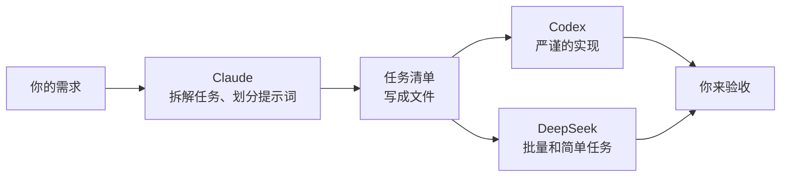

# 模型与 Harness 怎么选（持续更新）

写作、写代码、读论文、跑批量任务，该用哪个模型，放在哪个 Harness 里跑？这篇文档记录我目前的判断，并且会随着模型更新而修改。读完你可以按任务类型快速选出一个起手的组合，也知道怎么把便宜的模型和强的模型搭配起来用。

这些判断有时效。它们基于我 2026 年 11 月前后的使用体验，是个人经验，不是评测结论。模型几个月就会更新一轮，如果文末更新记录里的日期已经过去很久，就只当作线索，自己拿小任务试一遍再决定。

## 适合谁读

- 不知道某个任务该用哪个模型的同学。
- 想控制成本，又不想在质量上吃亏的同学。
- 已经会用单个工具，想学着组合使用多个模型的同学。

## 先看结论

| 任务 | 我的首选 | 原因 |
| --- | --- | --- |
| 复杂的任务拆解、方案设计 | Claude | 判断比较均衡，拆得清楚 |
| 严谨的代码实现和排错 | GPT 系列（Codex） | 比较严谨，改动稳 |
| 论文和长文写作 | Claude 或 Gemini | 文字自然，AI 味相对轻 |
| 批量、重复、容易验证的活 | DeepSeek | 速度快，成本低，学校有免费额度 |
| 一次性问答、查概念 | 带联网的对话产品 | 不需要 Agent |

这张表只是起点。同一个任务，换一个 Harness 或换一种提示方式，结果可能差很多，所以最后还是要看你自己试出来的手感。

## 几个模型系列的特点

| 系列 | 特点 | 适合 | 要注意 |
| --- | --- | --- | --- |
| GPT 系列 | 比较严谨，做开发很稳 | 写代码、排错、核对细节 | 不适合写作，防御性文字很重，AI 味也很重 |
| Claude 系列 | 比较均衡，文本和开发都不错 | 方案设计、任务拆解、写作和开发都要兼顾的场景 | 价格比较贵 |
| Gemini 系列 | 文本风格很好 | 写作、润色、总结 | 在 Harness 里的自主执行能力目前还有待提升 |
| DeepSeek 系列 | 速度快 | 批量任务、简单任务、成本敏感的场景 | 复杂任务的拆解和判断，建议交给更强的模型 |

用一句话概括就是，GPT 偏严谨，Claude 偏均衡，Gemini 偏文笔，DeepSeek 偏速度和成本。没有哪个模型在所有任务上都是第一，所以才值得组合使用。

## Harness 的选择

Harness 是模型外面的那层运行环境，决定了模型能读什么文件、能跑什么命令、怎么管理上下文。同一个模型放进不同的 Harness，表现可能差很多，这个概念在 [AI 使用实践](/ai_coding/ai_practice_and_boundaries.md) 里讲过。

常见的几种和它们各自的定位，已经在 [为什么使用AI编程](/ai_coding/why_ai_coding.md) 里介绍过，这里只说怎么选。

- 想用 Claude，优先用 Claude Code。
- 想用 GPT，优先用 Codex，国内使用的办法见 [通过中转站使用 Codex](/ai_coding/using_codex.md)。
- 想在一个 Harness 里自由切换多家模型，可以选 OpenCode 或 Pi 这类支持多模型的开源工具。
- 想理解 Harness 由什么组成，或者想自己改造，可以看 DeepSeek Harness 这类插件化的开源项目。

同济大学人工智能服务平台 [agi.tongji.edu.cn](https://agi.tongji.edu.cn) 提供免费的 DeepSeek 额度，也有开源的 Harness，生态比较丰富，简单任务和论文写作都可以用它来做。具体怎么登录和使用，请以平台页面为准。

## 组合调度，用强模型想，用便宜模型做

不同模型各有所长，也就可以分工。一个常用的做法是，让 Claude 做任务拆解和提示词划分，再让 Codex 或 DeepSeek 去执行。

这样做的好处是，贵的模型只花在最需要判断的环节，执行环节交给便宜或更擅长落地的模型。几个要点如下。

- 拆解的结果要写成文件，比如一份任务清单，执行的模型直接读文件，不要靠对话里的上下文传递。
- 每个子任务要自带验收标准，比如跑哪条命令、看到什么结果算完成，这样执行的模型才知道什么时候该停。
- 拆得越细，越适合交给便宜模型。拆不开的、需要权衡的部分，仍然用强模型。
- 无论谁执行，最后的验收都由你自己做。

## 不同类型的工作怎么搭配

下面是我的倾向，按任务类型列出。

| 工作 | 搭配 |
| --- | --- |
| 写论文初稿 | 用 Claude 或 Gemini 起草，再用去 AI 腔的 skill 处理，见 [用 AI 写论文](/ai_coding/ai_paper_writing_tutorial.md) |
| 核对论文里的数字和引用 | 用严谨的模型逐条核对，再自己回原文确认 |
| 读论文 | 先翻译，再让模型按审稿人视角讲解，见 [用 AI 读论文](/random_notes/reading_papers_with_ai.md) |
| 写代码 | 强模型出方案，Codex 实现，你来跑测试和验收 |
| 批量处理文件、整理资料 | DeepSeek 加简单的 Harness |
| 长时间无人值守的任务 | 先限定权限和目录，再放手 |

## 获取模型的几种途径

- 学校提供的免费额度，比如同济大学人工智能服务平台里的 DeepSeek，适合低成本地练手和跑批量任务。
- 通过中转站使用 Claude、GPT 等模型，选择方法见 [AI 中转站怎么选](/ai_coding/api_relay_station_selection.md)。
- 教育优惠，见 [GitHub Education](/ai_coding/github_education.md)，该页面已过时，申请政策常常先松后紧。

## 怎么保持这份判断是最新的

- 每次出新模型，用手头一个真实的小任务各跑一遍，对比结果，不要只看榜单。
- 把试出来的结论记下来，改在上面的表格里，并更新文末的日期。
- 发现某条判断过时了，直接改，不用保留旧说法。

## 更新记录

| 日期 | 改动 |
| --- | --- |
| 2026-11 | 初稿，记录四个模型系列的特点、Harness 的选择和组合调度的做法 |

## 延伸阅读

- [AI 使用实践](/ai_coding/ai_practice_and_boundaries.md)
- [为什么使用AI编程](/ai_coding/why_ai_coding.md)
- [AI 中转站怎么选](/ai_coding/api_relay_station_selection.md)
- [通过中转站使用 Codex](/ai_coding/using_codex.md)
