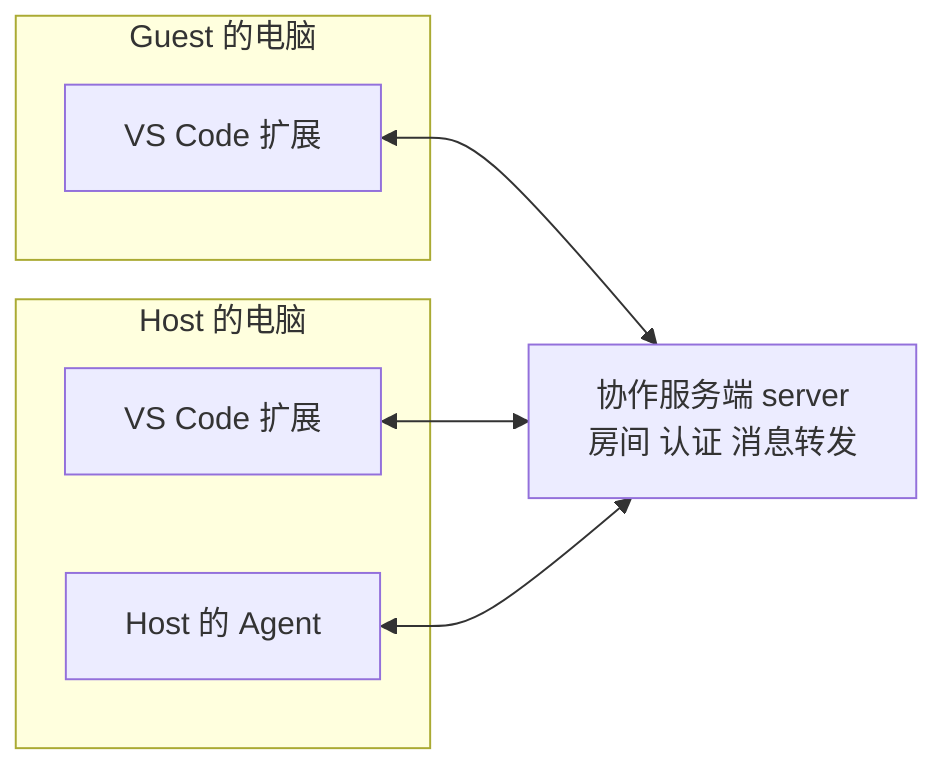
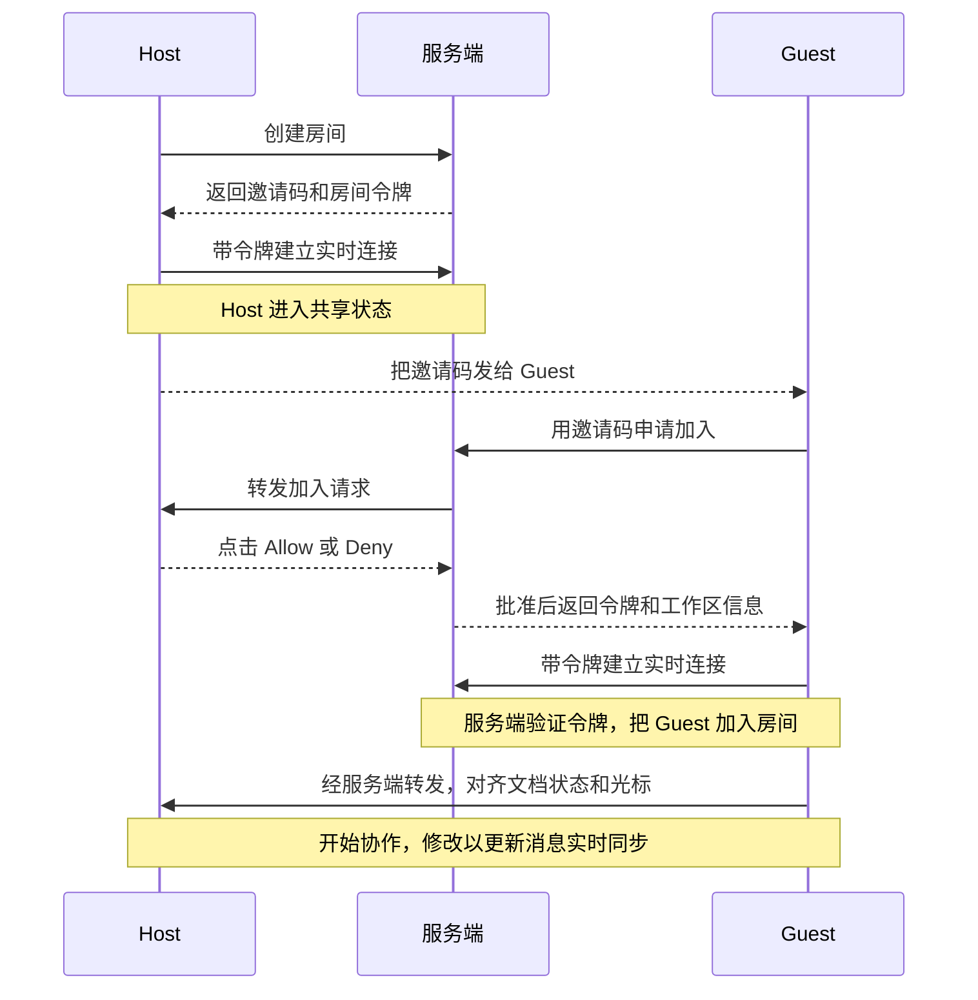
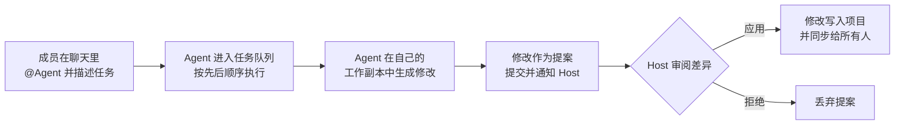

# Collaboration Tools 项目概览

Collaboration Tools 是一套让多人在各自的 VS Code 里实时共同编辑同一个项目的工具。我们在它的基础上加入了 Agent 协作能力，用来研究多人与多个 Agent 如何在同一个项目里一起工作。

读完这篇，你可以回答三个问题。这个项目能做什么，它由哪几块组成，一次协作会话在背后经历了什么。至于怎么把它跑起来，见 [如何运行](/collaboration_tools/how_it_works.md)。

## 适合谁读

- 刚加入课题组，需要先对底座有整体印象的同学。
- 准备在底座上做毕设或实验，想知道自己的改动会落在哪一块的同学。

## 它能做什么

一次协作会话里有两类角色。**Host** 是共享者，他打开本地项目并发起会话。**Guest** 是加入者，他通过邀请码进入同一个会话。

- **共同编辑**。两人同时修改同一个文件，彼此的修改实时同步，也能看到对方的光标和选区。
- **共享项目**。Guest 不需要把项目下载到本地，直接在自己的 VS Code 里访问 Host 的文件。
- **聊天**。会话里有一个聊天面板，成员可以交流。
- **Agent 协作**。成员可以在聊天里用 `@Agent名称` 把任务交给 Agent。Agent 生成修改后，Host 审阅并决定是否应用。
- **审计**。Host 会保存本次会话中 Agent 的审计记录，之后可以校验和生成报告。

## 整体架构

整个系统由三部分组成。客户端（VS Code 扩展和各个 Agent）和服务端通过网络连接，服务端只负责在房间里转发消息，文本内容的合并在客户端完成。

这张图里有三点值得记住。

第一，**服务端不保存也不合并代码**。它负责房间管理、认证，以及把一个人发的消息转发给房间里的其他人。

第二，**文本的一致性靠客户端保证**。每个客户端用 Yjs 维护一份文档，修改以更新消息的形式经服务端转发，对端合并后得到同样的结果，原理见 [数据模型与状态同步](/collaboration_tools/数据模型与状态同步.md)。

第三，**Agent 是房间里一个独立的成员**。它和人一样通过服务端加入房间，所以它的修改可以同步给其他人。

## 代码由哪几个包组成

仓库是一个 monorepo，`packages/` 下有 7 个包，各管一件事。

| 包 | 作用 |
|---|---|
| `open-collaboration-protocol` | 协议。定义客户端和服务端之间的消息格式和连接方式，其他包都依赖它 |
| `open-collaboration-server` | 服务端。管理房间、成员和认证，转发消息 |
| `open-collaboration-yjs` | 把 Yjs 文档和协议连起来，负责文本和光标的同步 |
| `open-collaboration-vscode` | VS Code 扩展。提供界面、命令、远程文件系统，是用户直接接触的部分 |
| `open-collaboration-agent` | Agent。接收聊天里的任务，在工作副本里生成修改并提交为提案 |
| `open-collaboration-monaco` | 把单个 Monaco 编辑器接入协作会话 |
| `open-collaboration-service-process` | 让非 TypeScript 的项目接入协作的服务进程 |

这些包之间的依赖关系和用到的技术，见 [技术栈与架构](/collaboration_tools/技术栈与架构.md)。

## 一次协作会话经历了什么

下面按时间顺序画出从创建到开始编辑的过程。

有几个细节在排查问题时很有用。

- Guest 一直转圈最后超时，最常见的原因是 Host 没有点 Allow。服务端等待 Host 回复的时限是 5 分钟。
- 一连上就断开，通常是令牌缺失或无效，服务端在握手时会校验。
- Guest 加入后，看到的是由扩展提供的 `oct://` 远程文件系统，文件内容来自 Host。

每一步对应的源码，见 [一次协作会话的源码走读](/collaboration_tools/session_code_walkthrough.md)。

## 人和 Agent 怎么一起工作

Agent 的任务从聊天开始，由 Host 把关最终修改。

几个要点如下。

- 每个 Agent 有自己的属主和独立的工作副本，不会直接改共享项目。
- 每个 Agent 的任务按先后顺序排队执行。
- 如果文件在审阅前被别人改了，提案会因冲突而失效，可以让 Agent 重新生成。

更多细节见 [如何运行](/collaboration_tools/how_it_works.md) 中的 Agent 协作方式。

## 接下来读什么

| 你想做什么 | 去看 |
|---|---|
| 把项目跑起来 | [如何运行](/collaboration_tools/how_it_works.md) |
| 了解用到的技术和包之间的依赖 | [技术栈与架构](/collaboration_tools/技术栈与架构.md) |
| 在底座上做二次开发 | [二次开发指南](/collaboration_tools/secondary_dev_guide.md) |
| 查某个模块的实现 | [源码参考手册](/collaboration_tools/source_reference.md) |

日常编码基本交给 AI，所以不需要通读源码。需要改某一块时，先读这篇和技术栈与架构，再让 AI 带着你看对应模块即可。
