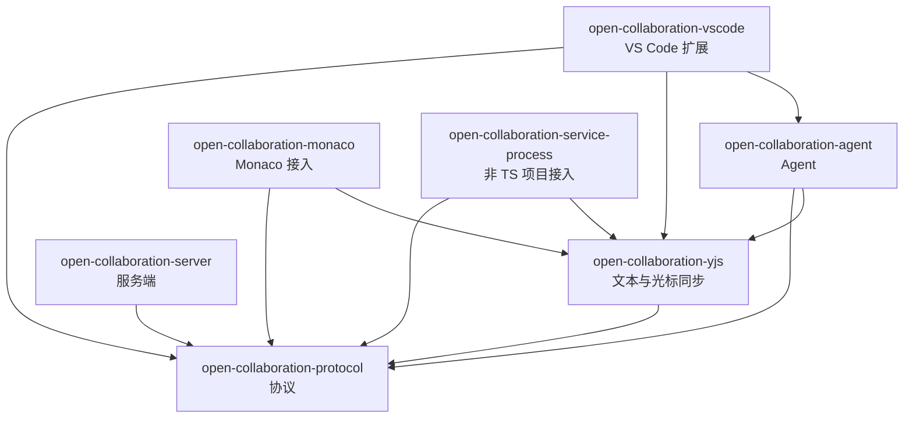

# 技术栈与架构

这篇文档回答两个问题。项目用了哪些技术，以及各个代码包之间是什么依赖关系。读完你可以判断，自己要改的功能应该落在哪个包里，会牵动哪些包。

整体的运行方式和一次协作会话的过程，先看 [项目概览](/collaboration_tools/project_overview.md)。

## 适合谁读

- 准备在底座上做二次开发的同学。
- 想知道某项技术在项目里用在哪里的同学。

## 包之间的依赖关系

下图的箭头表示左边的包依赖右边的包。依据是各个包 `package.json` 里的依赖声明。



从这张图可以读出几条规律，对二次开发很有用。

- **protocol 在最底层**。服务端和所有客户端都依赖它，改协议的消息格式会影响所有包。
- **服务端只依赖 protocol**，不依赖 Yjs，所以服务端不关心文档内容，只转发消息。
- **VS Code 扩展在最上层**，同时用到 Agent、Yjs 和协议，用户看到的功能大多在这里组装。
- 想做和编辑、界面相关的功能，主要改 `open-collaboration-vscode`。想改房间和认证，改 `open-collaboration-server`。想改 Agent 的行为，改 `open-collaboration-agent`。

每个包的详细讲解，见 [源码参考手册](/collaboration_tools/source_reference.md)。

## 技术选型

| 技术 | 用在哪 | 为什么选它 |
| --- | --- | --- |
| TypeScript | 全部包 | 类型安全，协议消息结构靠类型约束，编译期发现错误 |
| Yjs | `open-collaboration-yjs` | CRDT 算法，无需服务器仲裁冲突，客户端自动合并 |
| Socket.IO | server + protocol | 自动降级，内置重连，比裸 WebSocket 更稳定 |
| Express | server | 轻量，处理 HTTP 认证端点（`/api/login/*`） |
| InversifyJS | server + vscode | DI 容器，解耦服务生命周期，`autoBindInjectable` 减少样板代码 |
| msgpackr + fflate | protocol | 二进制编码 + 可选压缩，减少高频编辑时的带宽消耗 |
| npm workspaces | 根目录 | monorepo，包间引用不需要发布到 npm |

Yjs 和 CRDT 的背景知识，见 [Y.js](/tech_stack/yjs.md) 和 [OT算法 vs CRDT算法](/rcp/ot_vs_crdt.md)。

## Monorepo 构建

根目录 `package.json` 定义了 workspaces：

```json
"workspaces": [
  "packages/*"
]
```

所有子包共享依赖，`npm install` 在根目录执行一次即可。构建用 esbuild（`scripts/esbuild.ts`），TypeScript 编译用 `tsc -b tsconfig.build.json`。

## Docker 部署

```bash
docker compose build
docker compose up -d
```

服务端镜像基于 `node:lts-slim`，监听 8100 端口。`docker-compose.yml` 里默认通过环境变量 `OCT_ACTIVATE_SIMPLE_LOGIN=true` 开启简易登录，认证相关配置见 [安全与认证](/collaboration_tools/安全与认证/安全与认证.md)。启动整套协作流程的方法见 [如何运行](/collaboration_tools/how_it_works.md)。

## 延伸阅读

- [项目概览](/collaboration_tools/project_overview.md)
- [数据模型与状态同步](/collaboration_tools/数据模型与状态同步.md)
- [二次开发指南](/collaboration_tools/secondary_dev_guide.md)
