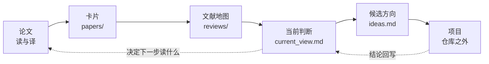

# 组内研究工作台：让 AI 带着读论文、做调研、想 idea

[科研全流程地图](/research/research_roadmap.md) 讲的是一个科研项目要走哪几步，这篇文档介绍组里实际在用的一个仓库，它把读论文、翻译、文献调研、想 idea 和改文字这些步骤做成了任何 AI 工具都能直接执行的工作流。读完你可以知道这个仓库是干什么的，里面有什么，能拿它做哪些事，以及没有访问权限时哪些做法可以直接借走。

仓库地址是 `cscw-and-se/migrate_rcp_to_agent_research`，目前是私有仓库，需要组内授权才能访问，向负责维护的同学申请即可。

## 适合谁读

- 刚进组、想知道组里的论文和判断记在哪里的同学。
- 想把读论文、做综述这类重复工作交给 AI 的同学。
- 想借鉴这套做法，给自己的课题建一个类似仓库的同学。

## 这个仓库是什么

它不是一个代码项目，而是一个研究知识库。内容全是 Markdown 和少量检查脚本，记录小组关于 AI 时代多人如何协作开发软件的问题、判断和文献。实时协同编程是组内积累，但不是选题的边界。

设计上有两个出发点。第一，任何 AI 工具打开它都能工作。规则只写在根目录的 `AGENTS.md` 里，Claude Code、Codex 或其他工具，只要先读这个文件，就知道内容放在哪里、证据怎么记、文字怎么写。第二，所有流程只靠读写文件、搜索和运行脚本完成，不依赖某一家工具的插件。

## 怎么用

获得访问权限后，克隆到本地，用你习惯的 AI 工具打开，然后对它说先读 `AGENTS.md`。之后就可以直接提需求，比如读一篇论文、翻译某篇的引言和方法、围绕某个主题做一份文献地图。

```bash
git clone git@github.com:cscw-and-se/migrate_rcp_to_agent_research.git
```

```bash
python3 scripts/check_project.py
```

第二条命令检查仓库是否符合约定，包括必需文件、内部链接和论文卡片的格式。改完内容后跑一遍。

## 里面有什么

内容按变化速度分成三类，这个分法本身值得借鉴。

| 类型 | 位置 | 放什么 | 怎么维护 |
| --- | --- | --- | --- |
| 沉淀 | `principles.md`、`papers/` | 选题和研究标准，论文卡片与 PDF | 写好后很少改 |
| 活跃 | `current_view.md`、`ideas.md`、`meetings/` | 当前判断、候选方向、组会要点 | 持续更新 |
| 快照 | `reviews/` | 带日期的综述 | 写完不再维护，过时后写新的 |

其余几个部分如下。

| 位置 | 内容 |
| --- | --- |
| `AGENTS.md` | 所有 AI 工具共用的唯一规则。内容放哪里、证据怎么记、文字怎么写，都在这里 |
| `current_view.md` | 我们想回答的几个问题，以及目前的判断。每条判断要写依据、置信度、日期，以及什么证据会推翻它 |
| `ideas.md` | 候选研究方向。每个方向要写清通俗解释、对应场景和证据、能否承接组内工作、最小验证方式和放弃条件 |
| `principles.md` | 组内长期适用的选题和研究标准 |
| `papers/group/` | 组内已发表论文的卡片和 PDF |
| `papers/external/` | 外部论文的卡片、中文导读译文和 PDF，按六个主题分目录 |
| `papers/README.md` | 论文阅读顺序，分成五站，从组内工作到协作理论 |
| `reviews/` | 带日期的综述和文献地图 |
| `meetings/` | 组会简记，只写决定、意见、待办和待确认事项 |
| `projects.md` | 具体项目不放在仓库里，这里只登记组内共享的项目 |
| `skills/` | 可复用的工作方法，共六个 |
| `scripts/` | 仓库检查脚本和文字风格扫描脚本 |

截至 2026 年 11 月，仓库里有 15 篇组内论文的卡片和 PDF，56 篇外部论文的中文卡片，其中 55 篇配有摘要、引言、研究方法和结论的中文译文，另有 66 份外部论文 PDF。外部论文按多人和 AI 协作、理解信任与控制、Agent 的实际使用、多 Agent 系统、评估与基准、实时协作与理论基础六个主题归类。这些 PDF 只限组内使用，仓库如果要公开，要先把它们从 git 历史中清除。

## 它可以用来做什么

| 你想做的事 | 怎么做 | 用到什么 |
| --- | --- | --- |
| 弄懂一篇论文 | 让 AI 按审稿人视角讲解，问题、已有工作、核心直觉、方法各讲一遍 | `paper-reading` 的讲解模式 |
| 把一篇论文入库 | 生成一张结构固定的中文卡片，写清证据等级和阅读范围 | `paper-reading` 的笔记模式 |
| 快速判断要不要细读 | 只翻译摘要、引言、研究方法、局限和结论 | `paper-translation` |
| 通读一篇 arXiv 论文的正文 | 下载源码，把正文译成中文并重排成 PDF | `arxiv-zh-translation` |
| 了解一个新领域和顶会趋势 | 填好提示词，让 AI 写一份文献地图 | `literature-review` 的 `map_prompt` |
| 做一个聚焦问题的综述 | 先定方案再检索，由人参与筛选 | `literature-review` |
| 一次读很多篇 | 把批量提示词交给 AI，每次 3 到 5 篇 | `paper-reading` 的 `batch_prompt` |
| 想 idea | 对照当前判断和已有 idea，把新想法按固定条目写进 `ideas.md` | `AGENTS.md` 中的 idea 规则 |
| 改学位论文或论文的文字 | 先改结构和论证，再扫描 AI 腔、翻译腔和口语化 | `thesis-writing-style` |
| 画论文插图 | 用 draw.io 画图，脚本检查字号和连线，导出矢量 PDF | `thesis-drawio-figures` |

下面是这些步骤之间的关系。读和译产生卡片，卡片支撑综述，综述和判断又反过来决定下一步读什么、想什么。



## 六个 skill

skill 是普通的 Markdown 文件，写明了一类任务该怎么做。任何能读文件的 AI 工具都可以照着执行，不限于某一家。

**paper-reading** 有两种用法。讲解模式用审稿人的视角回答四个问题，即研究问题、已有工作、核心直觉和具体方法，并要求严格区分论文原文的声明、已有结论、合理推断和猜测。笔记模式把论文整理成固定结构的中文卡片，包括快速介绍、背景、动机、解决方式、实验验证方式、工具模型与时效、证据核查和局限，并强制写出阅读范围，只读了摘要就必须说明。我的读论文提示词和这个讲解模式同源，见 [用 AI 读论文](/random_notes/reading_papers_with_ai.md)。

**paper-translation** 只翻译五个部分，即摘要、引言、研究方法、局限和结论，不总结也不评价。这样做的理由是，这几部分用作者自己的话写成，比 AI 的总结更可靠，读完就能知道研究问题、研究怎么做的以及结论能信多少。有 arXiv 源码时从源码翻译，否则读 PDF。文件头会写明译文依据的版本、许可和研究方式，并留出读后想法一栏给读者自己写。

**arxiv-zh-translation** 面向需要通读正文的情况。流程是确认 arXiv ID 和许可证、下载 LaTeX 源码、判断正文边界、用 ctex 重排、翻译、编译，再用 `check_zh_pdf.py` 检查。带 `fetch_arxiv.py` 下载脚本。翻译只是阅读辅助，不是官方译本。

**literature-review** 区分三种写法。想了解一个领域，写文献地图，也就是范围综述加叙事综述。想回答一个聚焦的问题，才做系统综述。只想决定先读哪几篇，列一个短清单。文献地图用三层筛选，先看完全部标题选候选，再逐篇读候选的摘要，最后让 40 到 60 篇进入正文并尽量读全文。提示词在 `map_prompt.md`，用的时候把主题、范围和要回答的问题填进方括号。

**thesis-writing-style** 来自一篇硕士论文的多轮精读，处理四类问题，即只会罗列、AI 腔、过度口语化和过度防御。附带词表、各部分写法指南和 `lint_thesis_text.py` 检查脚本。它的目标是写出有判断的学位论文语体，不是规避 AI 检测，是否允许使用 AI、是否需要声明，按学校规定办。和 [用 AI 写论文](/ai_coding/ai_paper_writing_tutorial.md) 讲的是同一类问题，但这个 skill 更完整，带脚本。

**thesis-drawio-figures** 把导师和评审对论文插图的意见变成可检查的规则，涵盖图型选择、字号、直线连线、留白、颜色语义和图中文字的措辞。脚本 `fit.py` 计算画布和字号，`lint_drawio.py` 检查违规项，附一个可运行的示例。

## 想 idea 是怎么做的

仓库里想 idea 不是自由发挥，而是有一套约束，几乎每一条都可以搬到自己的课题上。

- 新 idea 写进 `ideas.md` 时，必须写清通俗解释、对应的真实场景和证据、能否承接组内已有工作、选题自检的结果、最小验证方式，以及什么情况下放弃。承接不上就直接说承接不上。
- 当前判断要写依据、置信度和日期，并写明什么证据会推翻它。被推翻过的判断单独保留，不悄悄删掉。
- 先找真实场景再谈方法。选题要经得起一个常见的追问，既然 AI 可以直接写代码，为什么还需要这个。
- 带人参与的研究，事先写好研究问题、参与者、任务、条件、指标和分析计划。用 LLM 模拟参与者只用于 pilot 和调试，不能替代关于人的证据。

## 记录证据的规则

这部分最适合没有访问权限时直接借走，因为它不依赖仓库里的任何具体内容。

- 每篇文献都记录证据等级，分为同行评审、预印本、厂商自述和二手报道。
- 每篇文献都记录阅读范围，分为全文、部分章节和仅摘要。引用时只读过摘要的要标出来。
- 不编造引用、实验结果、日期、venue 或作者观点。没做过的实验就写没做过。
- 综述是带日期的快照，写完不改，过时后写新的，并写明这次调研没有覆盖什么。
- 影响研究方向的负面结果要保留。

## 做文献综述踩过的坑

下面几条来自 `literature-review` 里记录的教训，都是真实发生过的。

- 按关键词分类几千篇只能得到一堆计数，读者得不到有效信息，还会漏掉标题不含关键词的论文。
- 摘要里的数字要和正文对。有一篇论文摘要里的百分比，在正文结果里根本找不到。
- 结论要和证据类型匹配。写人和人的分歧，就不能引用 PR 描述和代码不一致的研究。
- 比例要写清分母，只对部分样本成立的数字不能写成整体比例。
- 结论写完要回头对表。正文表格写得谨慎，开头结论却说过头，是最常见的错误。
- AI 写的人工核对不算人工核对，没有真人参与就如实写。

## 可选的外部工具

如果要用 AI 走完从调研到论文的全流程，可以再装第三方维护的 [Academic Research Skills](https://github.com/Imbad0202/academic-research-skills)（简称 ARS）。Codex 用户用 [Codex 版本](https://github.com/Imbad0202/academic-research-skills-codex)。工作台本身不依赖它，组内反复用到的做法才会整理成仓库里的短 skill。

## 使用时的注意

- 卡片和译文由 AI 完成，未经人工校对。引用前要读原文，数字以原文为准。
- 译文属于衍生作品，只有 CC BY 这类许可才可以公开，其余只限组内使用，仓库公开前要先从 git 历史中清除。
- 影响研究方向的判断是活跃内容，会变。看到时先看日期，不要把一个月前的判断当作现在的结论。
- 涉及可识别被试的数据不进 git。

## 延伸阅读

- [科研全流程地图](/research/research_roadmap.md)
- [用 AI 读论文](/random_notes/reading_papers_with_ai.md)
- [用 AI 写论文](/ai_coding/ai_paper_writing_tutorial.md)
- [多人多Agent协同编程研究方向](/rcp/future_research.md)
- [毕设与论文时间线](/research/thesis_timeline.md)
